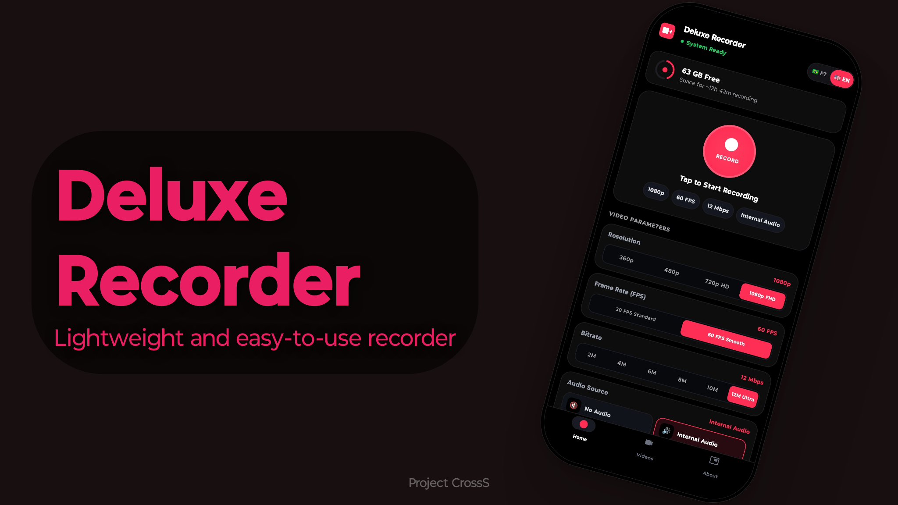

# 🔴 Deluxe Recorder

  

  
  
  
  
  

---

## ✨ Overview

**Deluxe Recorder** is a high-performance native screen recorder for Android crafted for gamers, content creators, and power users who demand pristine video quality, accurate audio synchronization, and total privacy wrapped in a modern **Dark AMOLED** design.

Capture crystal-clear gameplay and tutorials in **Full HD 1080p @ 60 FPS** with synchronized system audio and microphone playback at **real-time 1.0x speed** — with zero watermarks, zero ads, and zero artificial time limits.

---

## 🚀 Key Features

- 🎮 **Ultra-Smooth 60 FPS Capture**: Rock-solid frame pacing in 360p, 480p, 720p HD, and 1080p FHD with customizable bitrates up to 12 Mbps.
- 🔊 **Synchronized 1.0x Internal Audio**: Seamless recording of system audio and microphone with zero lag, no pitch distortion, and no speed glitches.
- 🖤 **Pure Dark AMOLED Interface**: Sleek True Black (`#0D0D0F`) and Crimson Neon (`#E91E63`) palette optimized for battery efficiency on OLED displays.
- 🚫 **Zero Ads & Zero Watermarks**: Completely clean recordings without any intrusive logo overlays or commercial interruptions.
- ⚡ **Quick Notification Controls**: Start, pause, resume, and stop recordings instantly from Android's notification shade.
- 🌐 **Instant Bilingual Toggle**: Switch dynamically with one tap between English (EN-US) and Portuguese (PT-BR).
- 📁 **Built-in Gallery & Player**: Inspect duration, resolution, and file size, or instantly play, share, and delete saved videos.
- 🛡️ **100% Offline & Private**: No cloud servers, no analytics, and no background tracking. Your media stays exclusively on your device.

---

## 📊 Feature Comparison

| Feature | Deluxe Recorder | Standard Play Store Recorders |
| :--- | :---: | :---: |
| **Watermark** | ❌ **None** | ⚠️ Requires payment or watching reward ads |
| **In-App Advertisements** | ❌ **Zero Ads** | ⚠️ Intrusive banners and pop-up videos |
| **Internal Audio (Android 10+)** |  **Synchronized 1.0x** | ⚠️ Desync, latency, or distorted speed |
| **1080p 60 FPS Recording** |  **100% Free** | ⚠️ Locked behind VIP/Pro subscriptions |
| **Dark AMOLED Theme** |  **Native Crimson** | ⚠️ Generic light or washed grey UI |
| **App Size** | ⚡ **Lightweight (~9.4 MB)** | ⚠️ Bloated (> 50-100 MB) |

---

## 📥 How to Download & Install

1. Navigate to the **[Releases](https://github.com/Deluxeblacktm/deluxe-recorder/releases/latest)** tab in this repository.
2. Download **`DeluxeRecorder.apk`**.
3. Open the downloaded APK on your Android device and confirm installation (allow *"Install unknown apps"* if prompted).
4. Launch **Deluxe Recorder**, grant screen capture & audio permissions, and start recording!

---

## ⚙️ System Requirements

- **Minimum Android Version**: Android 10 (API 29)
- **Target & Tested Versions**: Android 13, 14, and 15 (API 33-35)
- **Required Permissions**:
  - `FOREGROUND_SERVICE_MEDIA_PROJECTION`: Continuous background screen capture.
  - `RECORD_AUDIO`: Internal system sound & microphone recording.
  - `POST_NOTIFICATIONS`: Foreground service control buttons.

---

## 👨‍💻 Credits & Community

- **Lead Developer**: [Deluxeblacktm](https://github.com/Deluxeblacktm)
- **Official Project**: **Project CrossS**
- **Telegram Community**: [t.me/Projectcrosssoficial](https://t.me/Projectcrosssoficial)

---

## 📄 License

This project is licensed under the terms of the GNU General Public License v3.0 (GPL-3.0). See [LICENSE](LICENSE) for details.
